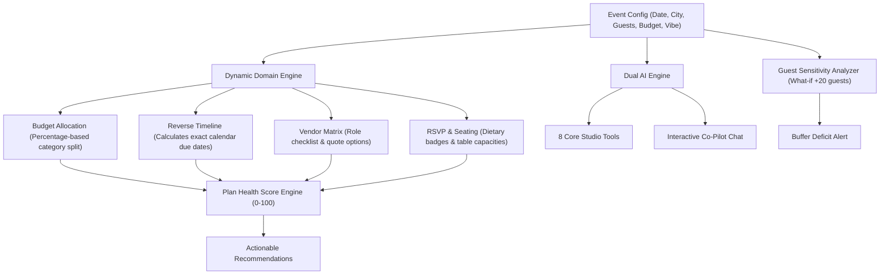

# ✨ Soirée — Next-Generation GenAI Event Planning Assistant

> An intelligent, context-aware event planning suite for **Weddings**, **Milestone Birthdays**, and **Community Gatherings**, powered by dual-mode AI (Google Gemini or an OpenAI-compatible API router, plus local offline reasoning), dynamic budget allocation, reverse-scheduled timelines, quote matrix comparison, interactive seating charts, RSVP & dietary tracking, and 8 specialized AI studio tools.

---

## 📌 Table of Contents
1. [Chosen Vertical](#-chosen-vertical)
2. [Problem Statement & Core Value](#-problem-statement--core-value)
3. [Approach & Logical Decision Making](#-approach--logical-decision-making)
4. [How the Solution Works](#-how-the-solution-works)
   - [Event Type Switcher & Domain Modeling](#1-event-type-switcher--domain-modeling)
   - [Live Overview, Countdown & Plan Health Algorithm](#2-live-overview-countdown--plan-health-algorithm)
   - [Guest Slider & Sensitivity Analysis](#3-guest-slider--sensitivity-analysis)
   - [Dynamic Budget Allocation & Real Spend Tracker](#4-dynamic-budget-allocation--real-spend-tracker)
   - [Reverse-Scheduled Milestones & Overdue Flags](#5-reverse-scheduled-milestones--overdue-flags)
   - [Vendor Checklist & Quote Matrix Comparison](#6-vendor-checklist--quote-matrix-comparison)
   - [Guest RSVPs & Special Dietary Tracking](#7-guest-rsvps--special-dietary-tracking)
   - [Interactive Seating Chart Builder](#8-interactive-seating-chart-builder)
   - [Mood Board & Palette Studio](#9-mood-board--palette-studio)
   - [AI Studio (The 8 Tailored Tools)](#10-ai-studio-the-8-tailored-tools)
   - [Real-Time Conversational AI Co-Pilot](#11-real-time-conversational-ai-co-pilot)
5. [Evaluation Focus Areas](#-evaluation-focus-areas)
   - [Code Quality & Architecture](#1-code-quality--architecture)
   - [Security & Privacy](#2-security--privacy)
   - [Efficiency & Performance](#3-efficiency--performance)
   - [Testing & Validation](#4-testing--validation)
   - [Accessibility](#5-accessibility)
   - [Problem Statement Alignment](#6-problem-statement-alignment)
6. [Assumptions Made](#-assumptions-made)
7. [Getting Started & Local Development](#-getting-started--local-development)
8. [Automated Test Suite](#-automated-test-suite)
9. [License](#-license)

---

## 🎯 Chosen Vertical

**Vertical:** **Event Planning & Celebrations**  
**Specialized Personas & Sub-Verticals:**
1. **The Wedding Planner / Couple:** Precision logistics, multi-month milestone countdowns, seating arrangements, heirloom aesthetic palettes, emotional toasts, and strict budget caps.
2. **The Milestone Birthday Host:** High-energy entertainment, surprise activations, rooftop and venue logistics, group RSVP coordination, and curated cocktail vibes.
3. **The Community Organizer & Non-Profit Lead:** Municipal permits, public safety, volunteer management, accessible wayfinding, and corporate sponsorship outreach pitches.

---

## 💡 Problem Statement & Core Value

> **Challenge:** Create a GenAI-powered planning assistant that helps users organize weddings, birthdays, and community events with budgets, timelines, vendor checklists, and personalized ideas.

Organizing high-stakes events is often fragmented across multiple disparate spreadsheets, notes, chat groups, and generic AI prompts that lack persistent context. **Soirée** consolidates planning into an integrated, reactive ecosystem:
- **Instant Domain Adaptation:** Switching event types dynamically reconfigures budget percentage splits, vendor checklists, reverse milestone countdowns, and aesthetic palettes.
- **Context-Preserving GenAI:** All AI prompts automatically incorporate event parameters (guest count, city, date, total budget, vibe, host names, and current spending variances).
- **Dual-Engine Architecture:** Supports live **Google Gemini** or a configurable **OpenAI-compatible chat completions API** for generative reasoning, alongside a local response engine that works without an API key.

---

## 🧠 Approach & Logical Decision Making



### Logical Tenets:
1. **Mathematical Grounding:** Event budgets are not static estimates. In Soirée, every dollar is tied to category caps. Logged spends trigger variance calculations, turning category progress bars red when exceeding thresholds.
2. **Reverse Timeline Scheduling:** Events happen on a fixed deadline. Milestones must be scheduled backwards ($T - 365\text{d}$, $T - 90\text{d}$, $T - 30\text{d}$, etc.) from the event calendar date to generate real actionable calendar deadlines. Tasks in the past with incomplete status are automatically flagged as `OVERDUE`.
3. **Plan Health Score Algorithm ($0 - 100$):**
   $$\text{Health Score} = S_{\text{budget}} (30) + S_{\text{timeline}} (30) + S_{\text{vendors}} (20) + S_{\text{rsvp}} (20)$$
   - *Budget Health (30 pts):* Deducts points for overall budget overruns, individual category breaches, and contingency buffer exhaustion.
   - *Timeline Pace (30 pts):* Penalizes overdue milestones while rewarding completed milestones.
   - *Vendor Coverage (20 pts):* Evaluates percentage of required vendors that are under contract or actively in quote stages.
   - *RSVP Status (20 pts):* Measures response rates and flags pending non-responders.
4. **Guest Sensitivity Modeling ("What if +20 guests?"):**
   Per-guest costs fluctuate based on venue minimums and catering contracts. The slider dynamically calculates the marginal catering surge:
   $$\Delta_{\text{spend}} = (\text{Catering Cost / Guest} + \text{Misc Rentals}) \times 20$$
   and alerts the planner if their emergency buffer is insufficient to absorb the surge.

---

## 🚀 How the Solution Works

### 1. Event Type Switcher & Domain Modeling
Switching between **Wedding**, **Birthday**, and **Community Event** adapts the entire application:
- **Wedding:** 8 categories (Venue & Catering 46%, Photography 12%, Decor 10%, Attire 8%, Music 8%, Buffer 13%), 13 reverse milestones, 7 specialized wedding vendors.
- **Birthday:** 6 categories (Venue 28%, Catering & Cocktails 32%, DJ & Audio 16%, Decor & 360 Booth 10%, Cake 8%, Buffer 6%), milestone checkpoints from 8 weeks out.
- **Community Gathering:** 7 categories (Permits 22%, Catering 26%, Staging & AV 20%, Marketing 12%, Volunteer Supplies 8%, Safety/Sanitation 6%, Buffer 6%), civic permits, volunteer drills, sponsor outreach.

### 2. Live Overview, Countdown & Plan Health Algorithm
- **Live Countdown:** Counts remaining days, hours, minutes, and seconds until event day.
- **Plan Health Gauge:** Interactive SVG circular progress ring indicating current health rating (*Excellent*, *Good*, *Fair*, *Critical*), with subscore bars and actionable 1-click recommendations.

### 3. Guest Slider & Sensitivity Analysis
- Smooth slider from 10 to 500 guests.
- Dynamically recalculates baseline cost per guest and projects the impact of +20 unexpected attendees on food, bar, chair rentals, and emergency buffer safety.

### 4. Dynamic Budget Allocation & Real Spend Tracker
- Displays allocated cap vs. actual logged spends with remaining balance per category.
- **Red Warning Bars:** Visually flags any category that exceeds its target percentage.
- **Expense Logger:** Modal to record payments, dates, and vendor payees.
- **1-Click AI Budget Hacker:** Analyzes line items and generates 5 concrete negotiation and trimming strategies.

### 5. Reverse-Scheduled Milestones & Overdue Flags
- Milestones calculate exact calendar due dates based on the target event date.
- Real-time overdue engine marks any task past today as a pulsating red `OVERDUE` badge.
- Filterable by *All*, *Overdue*, *Due Soon (Next 14d)*, and *Completed*.

### 6. Vendor Checklist & Quote Matrix Comparison
- Pre-populated and customizable vendor checklist by event type.
- Tracks quoted price, deposit paid, contact information, and 5-star ratings.
- **Quote Comparison Matrix:** Side-by-side comparison of candidate quotes (Option A vs Option B) with pros/cons and AI contract recommendations.

### 7. Guest RSVPs & Special Dietary Tracking
- Headcount breakdown: Confirmed attendees, plus-ones, pending responses, and regrets.
- **Dietary Restriction Badges:** Real-time counter for *Vegan*, *Gluten-Free*, *Halal*, *Nut Allergy*, and *Vegetarian* preferences.
- Quick action to draft AI WhatsApp/email reminders to pending guests.

### 8. Interactive Seating Chart Builder
- Visual table floor plan supporting Round tables (8 seats), Rectangular banquet tables (10 seats), and Head tables.
- Capacity monitoring ($N / \text{Capacity}$) with over-capacity warnings.
- Drag-and-click seating of confirmed guests directly from the unseated guest drawer.
- **Dietary Flags at Table Level:** Informs banquet servers which table requires allergy accommodations.

### 9. Mood Board & Palette Studio
- Curated aesthetic themes (*Champagne & Rose Gold Romance*, *Emerald Forest & Modern Botanical*, *Neon Sunset & Electric Retro*, *Civic Harmony*).
- **Interactive Color Swatches:** Hex codes with 1-click copy-to-clipboard and defined design roles (*Primary*, *Secondary*, *Accent*, *Neutral*, *Highlight*).
- Typography pairings (Serif display heading + Sans-serif body) and signature decor guidelines.

### 10. AI Studio (The 8 Tailored Tools)
1. **Theme Studio:** Bespoke aesthetic concepts, decor highlights, and color palettes with hex swatches.
2. **Master Run-of-Show:** Minute-by-minute operational schedule from load-in to midnight teardown.
3. **Multi-Tone Invite Writer:** 3 complete invitation suites (*Formal*, *Warm*, *Playful*) plus an instant 1-click WhatsApp/SMS short version with copy button.
4. **Toast & Speech Crafter:** Personalized toasts for Maid of Honor, Best Man, Host, or Keynote, with tone selection (*Gentle Humor*, *Sentimental*, *Roast*).
5. **Disaster Doctor:** Three-tier contingency protocols (*Plan A: Quick Pivot*, *Plan B: Indoor Flip*, *Plan C: Emergency Protocol*) with vendor communication scripts.
6. **Budget Hacker:** Strategic line-item cost reduction strategies saving 15-20% without sacrificing guest experience.
7. **Surprise Moments:** 5 unexpected wow-factors tailored to the guest demographic and vibe.
8. **Sponsor Pitch Deck:** Tiered packages (*Title*, *Gold*, *Community Champion*) and cold outreach emails for local businesses.

### 11. Real-Time Conversational AI Co-Pilot
- Drawer accessible from any screen for conversational queries, vendor email drafting, game suggestions, and real-time plan refinement.

---

## 🛡️ Evaluation Focus Areas

### 1. Code Quality & Architecture
- **Strict TypeScript:** Domain entities such as `EventDetails`, `BudgetCategory`, `Milestone`, `Vendor`, `Guest`, `Table`, and `MoodboardTheme` have explicit types.
- **Separated concerns:** Types, calculations, persistence, AI execution, and UI components are organized into focused modules.
- **Modular UI:** Event planning features are split into React components by responsibility.

### 2. Security & Privacy
- **Client-Side Privacy:** All plan data is saved in the user's browser `localStorage`.
- **Browser-Stored API Key:** The key is kept in browser `localStorage` and sent directly to the selected AI provider for live generation. Do not use this client-side setup in a public deployment; use a server-side proxy and secret storage there.
- **Sanitized Outputs:** All inputs and text areas are strongly typed with React escaping to prevent Cross-Site Scripting (XSS).
- **Client-side sharing:** Share links encode event details, budget categories and expenses, milestones, vendors, and the selected theme in the URL hash. They do not include guest lists or AI chat history. Links are not compressed or encrypted; anyone with a link can view its encoded plan data, so avoid sharing sensitive information.

### 3. Efficiency & Performance
- **Vite 6 Bundler:** Instant hot-module replacement and optimized tree-shaking.
- **Lightweight Production Build:** The current production output is approximately **434 kB** before gzip (**117 kB** gzipped across JavaScript and CSS).
- **Client-side calculations:** Budget allocations, countdowns, guest sensitivity, and plan health are calculated in the browser without additional server requests.

### 4. Testing & Validation
- **Vitest & React Testing Library:** 30 automated tests cover calculations, reverse-scheduled dates, health scores, guest sensitivity, persistence and sharing, AI provider requests and fallback, and UI behavior.
- **Automated validation:** Run `npm test` and `npm run build` to validate the current code.

### 5. Accessibility
- **Semantic controls:** Native buttons, navigation landmarks, labeled form fields, and dialog labels support assistive technologies.
- **State communication:** Selected event types, active planning sections, and copy feedback are exposed to assistive technology.
- **Keyboard focus:** Visible focus styles are provided for interactive elements. A formal WCAG conformance audit has not been performed.

### 6. Problem Statement Alignment
- Directly solves all requirements of the challenge statement: planning weddings, birthdays, and community events with dynamic budgets, reverse timelines, vendor checklists, and personalized GenAI ideas.
- Enhances usability through extended features: interactive seating chart builder, guest dietary tracker, vendor quote comparison, and shareable URL plans.

---

## 📌 Assumptions Made

1. **Client-First Architecture:** Planners prioritize privacy and instant offline access without mandatory account sign-up. All state is stored locally with optional URL hash sharing and JSON export.
2. **Dual AI Model:** Google Gemini or an OpenAI-compatible API router provides live LLM capabilities when configured with a key; when absent, the integrated local response engine supplies contextual offline responses.
3. **Reverse Milestone Standard:** Planning milestones count backwards from the event date, matching industry event coordinator practices.
4. **Standard Venue Sizing:** Seating chart defaults are based on standard banquet rental standards (Round tables = 8–10 seats; Rectangular tables = 8–12 seats).

---

## 💻 Getting Started & Local Development

### Prerequisites
- **Node.js:** v18.0.0 or higher (v24.x tested)
- **npm:** v9.0.0 or higher

### Installation
```bash
# 1. Clone repository
git clone https://github.com/Varshitha-Chereddy06/promptwars_5.git
cd promptwars_5

# 2. Install dependencies
npm install

# 3. Start local development server
npm run dev
```
Open [http://localhost:5173](http://localhost:5173) in your browser.

### Configure Live AI (Optional)
Open **Live AI / Local AI** in the top navigation, choose **OpenAI-compatible API router**, then enter the router's API key and a model name enabled by that provider. The API base URL defaults to `https://router.bynara.id/v1`; the app calls its `/chat/completions` endpoint. The URL must use HTTPS and must not contain credentials or query parameters. Live requests send the prompt and relevant event-plan context to that provider. Without a key, AI Studio and Co-Pilot use the built-in offline response engine.

The key is stored in this browser's `localStorage`, which is suitable only for personal local use. For a public deployment, route requests through a backend and keep the provider key server-side. The router must allow browser CORS requests for local development.

### Build Production Bundle
```bash
npm run build
```

---

## 🧪 Automated Test Suite

Run the automated test suite with Vitest:
```bash
npm run test
```

### Test Coverage Highlights:
- `src/test/calculationService.test.ts` — Tests countdown, reverse milestone date math, health score formulas, and +20 guest sensitivity.
- `src/test/storageService.test.ts` — Tests plan initialization, localStorage synchronization, URL hash encoding/decoding, API key storage, and AI provider settings.
- `src/test/aiService.test.ts` — Tests offline AI generation for all 8 tools and conversational co-pilot context injection.
- `src/test/components.test.tsx` — Validates Navbar, CountdownTimer, HealthScoreGauge, and GuestSensitivityCard rendering.

---

## 📄 License
MIT License. Built for the Prompt Wars Hackathon Challenge.
